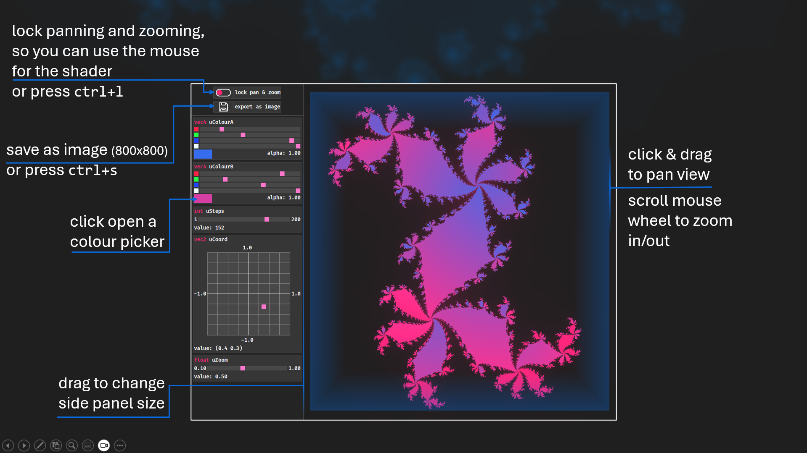
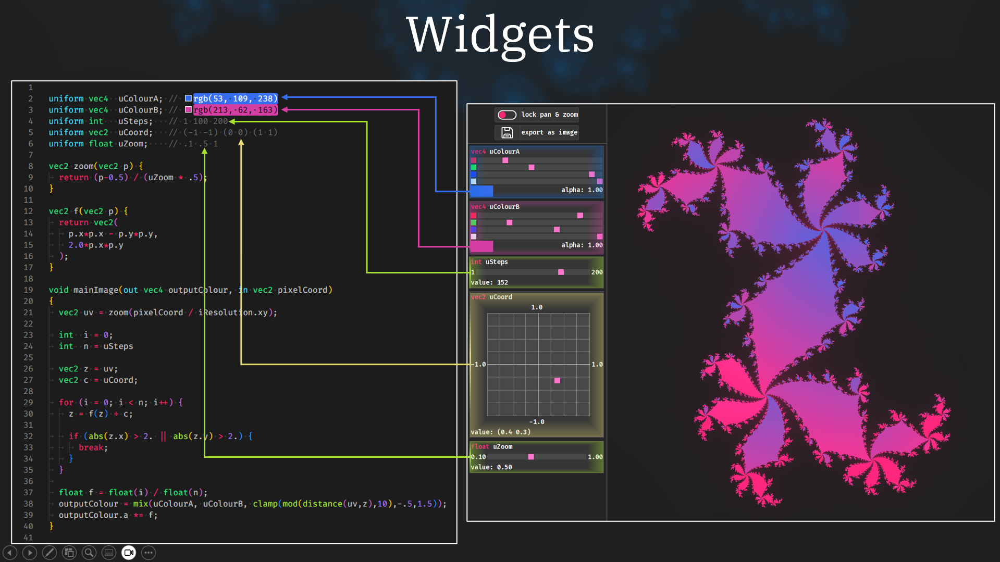
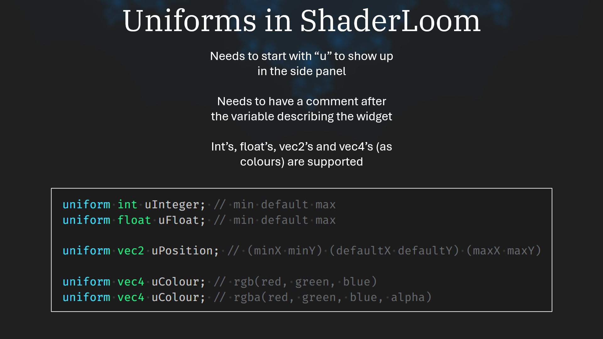

# shader-loom
a barebones glsl debugger with, compatible with many Shadertoy shaders.

The supported Shadertoy uniforms are:
- `iResolution` viewport resolution (in pixels)
- `iTime` shader playback time (in seconds)
- `iTimeDelta` render time (in seconds)
- `iFrameRate` shader frame rate (in frames per second)
- `iFrame` shader playback frame
- `iMouse` mouse pixel coords. xy: current (if MLB down), zw: click
- `iDate` (year, month, day, time in seconds)

## ShaderLoom interface

## Widgets
Shaderloom uses widgets to let you control uniforms, there are sliders for int's and float's, 2D coordinate grids for vec2's and colour pickers for vec4's.

You can define these widgets using a "u" infront of the uniforms name, and then specify the extra information needed

These Images are taken from [this slideshow](assets/readme/Workshop.pptx) which I made for my Computing Society Workshop in SETU Carlow.